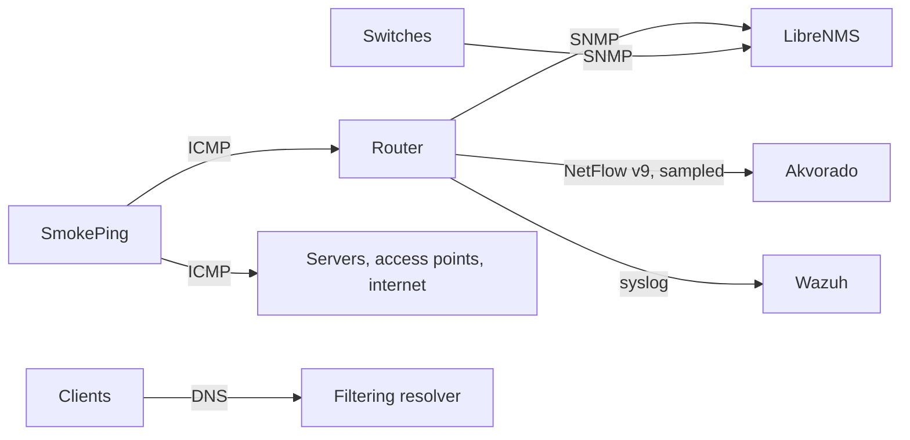

# A monitoring stack for a small network

Before this, the answer to "the internet is slow" or "was the link down last night?" was a guess. I wanted to be able to answer five questions with data, using open-source tools on two small virtual machines.

## One tool per question

| Question | Tool | Source of the data |
|---|---|---|
| Is something slow or losing packets, and since when? | SmokePing | ICMP probes to about two dozen devices and to the internet |
| What is the state and traffic of each port? | LibreNMS | SNMP from the router and the switches |
| Is a device up right now? | Router's own watchdog (Netwatch) | ping every 30 to 60 seconds, state changes go to the log |
| Who is talking to whom, and how much? | Akvorado | NetFlow v9 exported by the router |
| What happened on the router (logins, VPN, errors)? | Wazuh (SIEM) | syslog from the router |
| Which domains does each computer ask for? | Filtering DNS resolver | its own query log |

## Choices

**SNMP is read-only and reachable only from the management network.** Monitoring must not become a way to change the devices.

**NetFlow is sampled, one packet in a hundred.** It is enough to see which hosts and destinations dominate the traffic, and it keeps the load on the router and the size of the database small. It is not suitable for exact accounting.

**The router sends only useful log topics.** Critical, error, warning and informational messages go to the SIEM; debug and per-packet logging do not.

**The SIEM only observes.** Automatic blocking ("active response") stays off until the alerts have been reviewed for a while. A false positive that blocks the office is worse than a missed alert.

**The router configuration is applied by a script,** with a backup and a snapshot before it, so the logging and flow export can be reproduced after a reset. See [mikrotik-change-tools](https://github.com/alexpitea/mikrotik-change-tools).

**Every new device with a fixed address gets added to the probes.** A monitoring system that covers only the devices that existed on the day it was installed stops being trusted.

## Privacy

Query logs and flow records say what each person's computer connects to. Access to these tools is limited to the administrators, the DNS log is kept for 90 days, and the guest network is not logged by the office resolver at all.

## What it changed

- "Was the link down?" is answered by opening one graph.
- An access point that drops off the network is noticed the same minute, not when someone complains.
- During an outage there is a fixed order to check: the latency graphs first (is it the link or one device), then DNS, then the router.

## What I would do differently

- Start with the latency probes alone. They took an hour to set up and answer most day-to-day questions; the rest can come later.
- Decide the retention periods before turning the collectors on, not after the disks start filling.
